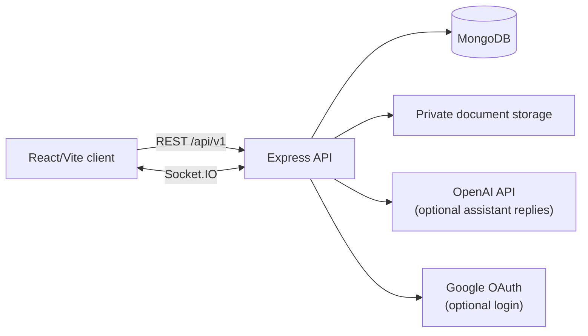

# QueueLess Government Office

QueueLess is a full-stack virtual queue and token-management system for government
offices. Citizens can discover offices, reserve a service token remotely, prepare
required documents, check in, and follow their place in the queue without waiting
at the office. Staff operate counters and advance the queue, while administrators
manage offices, services, staff, counters, analytics, and audit history.

The repository is split into two independently runnable Node.js applications:

- `client/` - React 19 single-page application built with Vite and Tailwind CSS.
- `server/` - Express 5 API backed by MongoDB/Mongoose and Socket.IO.

## Product capabilities

### Citizen experience

- Browse active government offices and their services without signing in.
- Register, sign in with email/password, or sign in with Google when configured.
- Book one active token per citizen, office, service, and queue date.
- View the token number, current queue position, predicted wait, estimated call
  time, assigned counter, check-in state, and token history.
- Check in at the office or use the secure token QR code at a staff counter.
- Cancel an eligible token before service begins.
- Upload, replace, and track PDF, JPEG, and PNG documents for services that require
  them. Document files are optional for token issuance; readiness is tracked
  separately.
- Receive in-app notifications and use the multilingual QueueLess Mitra assistant.

### Staff experience

- View assigned offices, counters, services, and live queues.
- Issue walk-in or staff-assisted tokens.
- Call the next token, start service, complete service, or mark a token missed.
- Change counter availability (`available`, `busy`, `paused`, or `offline`).
- Scan a citizen's signed QR payload to verify check-in.
- Review only document submissions allowed by the staff member's office and counter
  assignments, then approve, reject, or request replacement documents.

### Administrator experience

- Create and update offices and their services.
- Manage staff and counters, including supported services and assignments.
- View overview and hourly queue analytics.
- Inspect audit logs for token, queue, and document-review actions.

## Architecture



### Client application

The client uses React Router for public, citizen, staff, and admin routes. Pages
are lazy-loaded and rendered inside an error boundary and Suspense loading state.
`AuthContext` restores the session on startup, stores the short-lived access token,
and connects the user to a private Socket.IO room. Axios interceptors attach the
access token and coordinate a single refresh request when several requests receive
`401` responses at once. TanStack React Query owns server-state fetching,
refetching, invalidation, and mutations.

The highlighted citizen token page is
[`TokenDetailPage.jsx`](client/src/pages/citizen/TokenDetailPage.jsx). It:

1. Fetches a token by route parameter and refreshes it every five seconds.
2. Loads the linked document submission when one exists.
3. Generates a QR image from the server-provided signed QR payload; the secret
   nonce is never exposed by the API.
4. Joins the office queue room and invalidates the token query on
   `queue:updated` and `token:called` events.
5. Shows status-sensitive UI for called, in-service, completed, and cancelled
   tokens.
6. Offers self check-in and cancellation mutations with user-visible toast
   feedback.
7. Renders the service's document checklist when document requirements are present.

### Server application

`server/app.js` configures security headers, CORS, compression, cookies, request
logging, body-size limits, rate limiting, health checks, API routes, and the
central error handlers. `server/server.js` adds the HTTP and Socket.IO servers,
connects to MongoDB, schedules document-retention cleanup, and performs graceful
shutdown.

The API is organized into:

- **Routes** - URL and role/validation middleware composition.
- **Controllers** - HTTP request/response orchestration.
- **Services** - queue, prediction, authentication, document, and assistant
  business logic.
- **Models** - Mongoose persistence schemas and indexes.
- **Middlewares** - authentication, validation, uploads, and error handling.
- **Utils/config** - JWT and QR helpers, file-signature detection, environment
  configuration, and database connection.

### Queue lifecycle

Tokens move through the following states:

`issued -> checked_in -> called -> in_service -> completed`

They may also become `missed`, `cancelled`, or `expired`. Queue sequence numbers
are allocated atomically per office, service, and date. A partial unique index
prevents a citizen from holding more than one active token for the same service
on the same day. Queue predictions are recalculated as the queue changes and
relevant updates are broadcast to office, service, user, and admin Socket.IO
audiences.

### Document lifecycle

Each service can define current `documentRequirements` and retains support for
legacy `requiredDocuments`. A citizen starts a draft submission, uploads files,
and associates the submission with a token. Staff review files within their
authorized office/service scope. Submission states are:

`draft -> submitted -> under_review -> ready`

Reviews can also lead to `needs_changes`. Files are stored outside public static
assets, validated by content signature, limited to 10 MB, and served only through
authenticated ownership/assignment checks. A daily cleanup job removes expired
file contents while retaining review metadata.

## Route map

### Browser routes

| Area | Routes |
| --- | --- |
| Public | `/`, `/offices`, `/offices/:officeId` |
| Authentication | `/login`, `/register` |
| Citizen | `/dashboard`, `/book-token`, `/tokens/:tokenId`, `/history`, `/notifications`, `/profile` |
| Staff | `/staff`, `/staff/queue`, `/staff/counter`, `/staff/documents`, `/staff/documents/:submissionId` |
| Admin | `/admin`, `/admin/offices`, `/admin/staff`, `/admin/counters`, `/admin/analytics`, `/admin/audit` |

### API route groups

All API routes are mounted below `/api/v1`:

| Group | Responsibility |
| --- | --- |
| `/auth` | Registration, login, Google login, refresh, logout, profile |
| `/offices` | Public office/service discovery and admin management |
| `/tokens` | Citizen token booking/history/detail/check-in/cancellation and staff queue operations |
| `/documents` | Drafts, uploads, citizen downloads, staff review queue and review actions |
| `/notifications` | Notification listing and read state |
| `/assistant` | QueueLess Mitra chat |
| `/admin` | Analytics, staff, counters, and audit logs |

Operational endpoints are `/health` and `/`.

## Repository structure

```text
.
├── client/
│   ├── src/
│   │   ├── components/
│   │   │   ├── layout/          # Public, citizen, staff, and admin shells
│   │   │   ├── staff/           # Staff QR scanner
│   │   │   └── ui/              # Assistant, loading, document checklist
│   │   ├── contexts/             # Authentication/session context
│   │   ├── lib/                  # Axios API, React Query, Socket.IO clients
│   │   ├── pages/
│   │   │   ├── public/            # Landing, office list/detail
│   │   │   ├── auth/              # Login and registration
│   │   │   ├── citizen/           # Citizen token and profile workflows
│   │   │   ├── staff/             # Queue, counter, and document review
│   │   │   └── admin/             # Management and reporting
│   │   ├── App.jsx                # Route guards and application router
│   │   └── main.jsx               # React entry point
│   ├── vite.config.js             # Alias, dev server, REST and WebSocket proxy
│   └── package.json
├── server/
│   ├── src/
│   │   ├── config/                # MongoDB and environment configuration
│   │   ├── controllers/           # HTTP controllers
│   │   ├── middlewares/           # Auth, validation, uploads, errors
│   │   ├── models/                # User, office, service, queue, token, document, audit data
│   │   ├── routes/                # API route groups
│   │   ├── services/              # Queue, prediction, auth, document, assistant logic
│   │   ├── scripts/               # Idempotent demo database seed
│   │   ├── utils/                 # JWT, QR, file, and shared helpers
│   │   └── validations/            # Zod request schemas
│   ├── test/                      # Node tests for QR, document validation, and file detection
│   ├── app.js                     # Express app
│   ├── server.js                  # HTTP/Socket.IO startup and shutdown
│   ├── .env.example
│   └── package.json
└── README.md
```

## Prerequisites

- Node.js 20 or newer is recommended.
- npm.
- MongoDB (local or hosted).
- A browser with JavaScript enabled. Speech recognition/read-aloud are
  progressive enhancements and depend on browser/device support.

## Local setup

Install dependencies in each package:

```powershell
npm install --prefix server
npm install --prefix client
```

Create the server environment file:

```powershell
Copy-Item server/.env.example server/.env
```

At minimum, set a reachable `MONGO_URI`, a database name, and a random
`TOKEN_QR_SECRET` with at least 32 characters. Keep access-token, refresh-token,
Google, and OpenAI secrets server-side.

Start the API in one terminal:

```powershell
npm run dev --prefix server
```

Start the Vite client in another:

```powershell
npm run dev --prefix client
```

The development URLs are normally:

- Client: `http://localhost:5173`
- API: `http://localhost:5000`
- Health check: `http://localhost:5000/health`

Vite proxies `/api` and `/socket.io` to the local API. For a separately hosted
API, set `VITE_API_BASE_URL` in the client environment to the API origin expected
by `client/src/lib/api.js`.

## Demo data

After configuring MongoDB, populate offices, services, counters, users, and
historical service data:

```powershell
npm run seed --prefix server
```

The seed script is idempotent. It creates demo credentials including:

| Role | Email | Password |
| --- | --- | --- |
| Admin | `admin@queueless.app` | `Admin@1234` |
| Citizen | `aarav@demo.queueless.app` | `Demo@1234` |
| Citizen | `priya@demo.queueless.app` | `Demo@1234` |
| Citizen | `rohan@demo.queueless.app` | `Demo@1234` |

Change or remove these credentials before using a shared or production database.

## Environment reference

The complete template is in [`server/.env.example`](server/.env.example).

| Variable | Purpose |
| --- | --- |
| `NODE_ENV`, `PORT` | Runtime mode and API port |
| `MONGO_URI`, `DB_NAME` | MongoDB connection |
| `ALLOWED_ORIGINS` | Comma-separated browser origins allowed by CORS |
| `ACCESS_TOKEN_SECRET`, `REFRESH_TOKEN_SECRET` | JWT signing secrets |
| `ACCESS_TOKEN_EXPIRATION`, `REFRESH_TOKEN_EXPIRATION` | JWT lifetimes |
| `GOOGLE_CLIENT_ID` | Optional Google sign-in |
| `OPENAI_API_KEY`, `OPENAI_MODEL` | Optional live assistant replies |
| `DOCUMENT_STORAGE_PATH` | Private document directory |
| `DOCUMENT_RETENTION_DAYS` | File-content retention period; defaults to 90 |
| `TOKEN_QR_SECRET` | Required signing secret for token QR payloads |
| `DEMO_MODE` | Enables configured demo behavior |

### QueueLess Mitra assistant

The assistant supports automatic or manual Gujarati, Hindi, English, Hinglish, and
Gujarati-English mixed language selection, simple/standard/senior-friendly reply
styles, and browser voice input/read-aloud where supported. It can verify the
signed-in citizen's own active token through authenticated token APIs, but it
cannot book or cancel a token through chat. Verified token details are kept out
of AI conversation history.

To enable live replies, configure these server-only variables:

```env
OPENAI_API_KEY=your_api_key_here
OPENAI_MODEL=your_enabled_text_model
```

If the key is missing, rejected, rate-limited, over quota, or the provider is
unavailable, the assistant labels its response as demo guidance and uses its
built-in non-live answers. It does not invent token data, wait times, office
policies, or completed actions.

### Document storage

Development files are written under `server/private-documents` by default and
are excluded from Git. Files are never exposed through a public static directory.
For production, replace the local disk adapter with private object storage and
add backups, encryption at rest, malware scanning, and access policies. The
document feature does not send uploaded files to the assistant or an external OCR
provider.

## Development commands

### Client

```powershell
npm run dev --prefix client       # Vite development server
npm run build --prefix client     # Production build
npm run lint --prefix client      # ESLint
npm run preview --prefix client   # Preview the production build
```

### Server

```powershell
npm run dev --prefix server       # Nodemon development server
npm start --prefix server         # Start without file watching
npm test --prefix server          # Node test runner
npm run seed --prefix server      # Seed demo data
```

The current server tests cover QR signing/verification, document validation,
and document file-signature handling. The client package currently provides
build and lint scripts but no separate test script.

## Security and operational notes

- Do not commit `.env` files, JWT secrets, API keys, or private document files.
- Use strong, unique secrets in every non-local environment.
- Keep `ALLOWED_ORIGINS` restricted to the deployed client origins.
- Authentication uses access and refresh JWTs; authenticated requests are sent
  with credentials and an access-token header.
- Helmet, CORS, compression, request-size limits, rate limiting, validation, and
  centralized error handling are enabled at the API boundary.
- Token QR payloads are signed and verification nonces are hashed in MongoDB.
- Citizen token access is restricted to the owner, staff, or administrators.
- Staff document access is restricted by assigned office and supported counter
  service.
- The local filesystem document backend is suitable for development or a single
  persistent server, not a highly available production deployment.

## License

The server package declares the MIT license. Confirm the intended distribution
license for the complete client/server repository before publishing a release.
